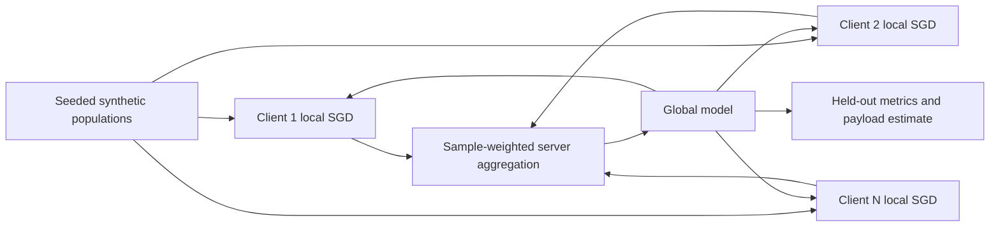

# Federated Learning Lab

A reproducible Python lab for studying how federated optimization behaves when clients hold non-IID data. It compares FedAvg and FedProx on a synthetic binary-classification task, tracks held-out loss and accuracy by round, and estimates model-payload communication.

This is a compact ML experiment, not a distributed training framework: clients are simulated in one process, and all examples are synthetic.

## Why this is different

The portfolio already contains retrieval, RAG, LLM evaluation, data lineage and model rollout examples. This project focuses on a different AI systems problem: optimizing one shared model when training data stays partitioned across heterogeneous clients.

## What it demonstrates

- Dirichlet-controlled class imbalance and per-client feature shifts.
- Sample-weighted FedAvg and the FedProx local objective.
- Partial client participation with reproducible sampling.
- Per-round held-out loss, accuracy and estimated uplink/downlink bytes.
- A balanced shared synthetic test set for comparable runs.



## Quick start

```bash
uv sync --extra dev
uv run fedlab --algorithm fedavg --rounds 30 --clients 8
uv run fedlab --algorithm fedprox --rounds 30 --clients 8 --proximal-mu 0.05 --output results/fedprox.json
```

The CLI prints a JSON result with final weights, round-by-round metrics, and an estimated total communication payload. Seeds default to fixed values so runs are reproducible. Adjust `--dirichlet-alpha` to vary label skew; smaller values generally create more uneven client class rates.

## Python API

```python
from fedlab import make_synthetic_federation, train_federated

data = make_synthetic_federation(seed=7, n_clients=8, dirichlet_alpha=0.35)
result = train_federated(data, algorithm="fedprox", rounds=30, proximal_mu=0.05)
print(result.history[-1].test_accuracy)
```

## Run checks

```bash
uv run ruff check .
uv run pytest -q
```

GitHub Actions runs Ruff and pytest on Python 3.11, 3.12 and 3.13.

## Interpretation and limits

- The model is a small NumPy logistic classifier; this is not a transformer, LLM, or neural-network benchmark.
- Synthetic clients and one-process execution do not model real devices, network failures, stragglers, secure aggregation, or deployment.
- Keeping examples local in this simulator is not a privacy guarantee. Gradients and model updates can leak information; there is no differential-privacy mechanism or formal accountant.
- Communication is an estimate of raw float64 parameter payloads in both directions; it excludes protocol headers, compression, retries and transport overhead.
- Results depend on the synthetic data generator and settings. They do not establish that FedProx is universally better or predict production performance.

## License

MIT
